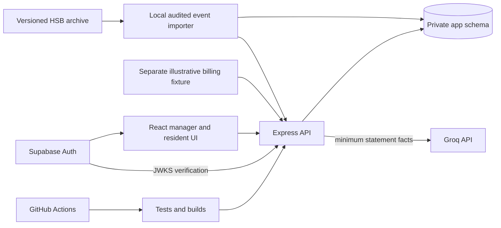

# Smart Water Metering Platform — Architecture Design

**Updated:** 2026-10-28
**Status:** Stage 4 locally verified, deployment pending
**Authoritative requirements:** WATER_METERING_BUILD_PLAN_v4.md

This living document records why the system is shaped as it is. Update it when implementation changes a boundary, invariant, source mapping, or deployment decision. Record measured behavior in PROGRESS.md and raw result files, not as an unsupported design claim here.

## Product boundary

The product is software for an apartment building with compatible water meters. The portfolio case study uses anonymized, historical HSB Living Lab measurements from Sweden. The first release demonstrates ingestion, coverage-aware apartment usage, an illustrative invoice allocation, resident statements, and Groq explanations. It is not installed at the research building.

| Input or output | Provenance | What may be claimed |
|---|---|---|
| HSB fixture consumption events | Observed, published research data | Historical event-volume analytics after verified import, with unit and coverage caveats |
| Apartment event sums | Deterministically derived from mapped source sensors | Historical analytics only; no coverage-certified billing total |
| Demo invoice and resident charges | Illustrative assumptions plus deterministic calculation | Correct reconciliation and counterfactual allocation |
| Duplicate, gap, reset, and failure cases | Injected test fixtures | Reliability and fault-handling results, labeled as tests |
| Groq explanation | Model output validated against backend facts | Measured agreement on a frozen evaluation set |

## Tooling and reproducibility

The active workspace uses npm 11.20.0, `package-lock.json`, and `npm ci` locally, in Docker, and in the GitHub Actions workflow. Local workspace packages use pinned `0.0.0` versions linked by npm. The prior pnpm lockfile is archived for historical Stage 1/2 evidence; existing raw benchmark JSON and its recorded commands remain unchanged. The npm migration does not change ingestion, provenance, billing eligibility, or database boundaries.

The server is a modular monolith. Stage 3 adds `billing/allocation.ts` for pure integer arithmetic and fixture validation and `billing/api.ts` for JWT/profile authorization and publication transactions. `ingest.ts` composes these beside the separate source-event route. React composes a source-event caveat section and a fictional billing walkthrough; it signs in through Supabase Auth and sends the access token only to Express. The exact Stage 2 benchmark source and raw evidence remain preserved.

## Components and trust boundaries

- React gets application data only through Express. A Supabase access token proves identity; Express loads society, role, and apartment authorization from its database.
- Application tables live in a non-exposed schema. The API uses a limited runtime database role; migrations use a separate credential.
- The archive and importer are a data-ingestion boundary. The importer validates metadata, mappings, units, timestamps, and row identity before the Stage 2 API persists source events.
- Groq receives only the authorized statement facts needed to select explanation reason codes. It cannot write bills, calculate charges, or access another resident's data.
- Render hosts the API and static UI. Supabase hosts PostgreSQL/Auth. Local Docker PostgreSQL and tooling support repeatable tests and benchmarks.
- The [Stage 4 deployment plan](DEPLOYMENT_PLAN.md) makes the hosted connection, small-seed, environment, smoke-check, and fallback boundaries explicit. Supabase's session pooler, managed privileges, Auth/JWKS, and private-schema denial were verified on this account; Render deployment remains a release gate.

## Data flow 1 — Source audit and import

1. Pin the Zenodo record/version, cite the article, verify licence and archive checksum, and read the data dictionary.
2. The [full Stage 1 audit](data/HSB_AUDIT.md) found positive timestamped **events**, zero filtering, 701 repeated sensor/timestamp keys, and a dictionary/source-value unit contradiction. `docs/data/hsb-profile.json` preserves the field profile and each sensor's fixed tuple.
3. The 214 sensors map to 152 apartment sensors and 62 blank-apartment/shared-or-unattributed sensors. A stable source tuple is preserved, but a blank apartment is never inferred from cluster or room.
4. The importer and HTTP adapter share `hsb-parsed-fields-json-v1`: SHA-256 of UTF-8 JSON serialization of all 16 parsed string fields in published header order. It is not a raw-byte hash. The existing `hsb-event-1.0.0` stored rows retain their hashes; see decision 002. The aggregate-supported m³ interpretation converts `value` to integer millilitres, with Q-05 still open. The unit discrepancy remains explicit in the manifest.
5. The authenticated HTTP **source-event** batch API verifies the pinned manifest, server-held CSV line hash, and audited sensor tuple. It derives provenance, commits at most 500 accepted/duplicate/conflict/rejected outcomes with a batch record, and stores conflicts in migration 003. The server-held credential and archive file gate this import; ordinary resident/manager JWT authorization is a separate Stage 3 boundary. The local 1,000-row import replayed via HTTP as 1,000 duplicates. A future interval feed needs its own contract.
6. The HSB file cannot certify a complete common billing window: removed zero rows and missing heartbeat/status data make absence ambiguous. Source event sums are analytics only. Stage 3 uses the separated illustrative test fixture for billing, without an invented main meter.
7. Stage 3 exposes a read-only summary restricted to the pinned HSB DOI, archive SHA-256, dataset version, and adapter version. It returns observed event count, apartment-pseudonym count, derived event sum as a decimal millilitre string, event range, and last import time with `coverageCertified: false`. The React source panel renders those fields apart from fictional statements. It never joins `source_events` to billing tables.

## Data flow 2 — Billing and statements

The manager creates a draft billing period and invoice. In the public demo, the invoice is explicitly illustrative, derived from a documented fixed fee and unit rate. The source dataset supplies neither a matching utility invoice nor physical main-meter readings. An actual manager-entered invoice can be accepted by the product; if a physical main meter is available, its volume must reconcile with the invoice.

Stage 3 validates the complete six-interval `billing-demo-v1` fictional fixture and its Asia/Kolkata boundaries. The fixture's two flat IDs must exactly match the chosen society's configured flats. It has no physical main meter or shared bucket; statement shared charge is zero. A manager enters an illustrative invoice, and invoice volume, when supplied, must match the fixture's flat total. The documented example is 5,000 mL at 100 paise/L = 500 paise variable plus 200 paise fixed = 700 paise total. Pure functions allocate variable charge by volume and fixed charge equally with integer largest-remainder rounding and flat-ID tie-breaking. Zero allocatable volume with positive variable charge blocks publication. HSB source events are never queried by the billing module.

Preview returns a hash of the canonical fixture, invoice, bill version, allocation rule, and calculated statements. Publication locks the period row, recomputes from that row and the versioned server-held fixture within one transaction, and checks the submitted hash. A stale hash returns 409. A transaction-scoped advisory lock serializes each society/operation/idempotency key; the period row lock serializes distinct concurrent keys. The same key and request hash returns the stored response; changed input returns 409. Publication inserts revision, statement snapshots, lines, audit event, and idempotency response together. Revision creation reopens a draft and increments bill version; prior published rows have no runtime UPDATE grant. Resident reads are filtered by both profile society and flat. Test tokens are locally signed ES256 and verified through the same `jose` path as remote Supabase JWKS tokens. Three real fictional Supabase Auth users were created and their returned UUIDs mapped to private manager/resident profiles; a local API with the hosted database passed sign-in, role, flat, and revision smoke checks.

Stage 3 billing integration and Playwright tests use the isolated `water_metering_bench` database. Their reset statements never target the main local database, preserving previously published local revisions. The manager period-list query has a saved pre-index plan and a forward-only index migration; the raw single-run plans are local diagnostics, not a throughput claim.

Migration 008 resolves the period-ID locking gap. It first ranks existing equal-window rows per society by earliest publication and keeps one active canonical period. Other rows retain their IDs and all child revision, statement, and audit records, with `superseded_by_period_id` pointing to the canonical period. A partial unique index permits only one active `(society_id,period_start,period_end)` row. The runtime database role has column-scoped INSERT/UPDATE grants that exclude the marker, so it cannot create an audit-only row to bypass the index. Create-draft uses the index as the concurrency arbiter and returns 409 plus the existing active period ID. Preview, publication, and revision creation reject audit-only period IDs; resident statement detail can still read their historical revisions. The manager UI reads the active period list after sign-in and resumes its draft after refresh. This policy covers exact windows; the current API accepts only the fixed fictional fixture window, so overlapping distinct windows are outside this repair's write contract.

Stage 1 found no defensible common billing window. The UI must show source-data analytics separately from a labeled test-fixture billing walkthrough. It must not combine observed usage with an incomplete or fabricated bill.

## Data flow 3 — Explanation

The API builds a minimal fact set from a resident's authorized published statement and prior published revision of the same period. Groq returns constrained reason codes, fact references, and a short number-free summary. Zod checks the response, the API rejects unsupported fact references or numeric prose, and the backend renders all displayed figures from stored billing facts. A cache key includes statement revision, model, prompt version, and facts hash. Timeouts, rate limits, and invalid outputs trigger a deterministic fallback outside the billing transaction.

Stage 4 implements this with Groq's documented strict JSON schema mode on `openai/gpt-oss-20b`, a two-attempt/3.5-second bound, per-process and per-resident minute limits, and forward-only migration 009. Only validated selections enter the private cache. The backend renders the visible explanation from its deterministic reason template and stored paise values. A model call starts only after the resident's published statement and prior revision have been read outside a transaction. The React page requests explanations only on a resident click. The static source-audit snapshot is labeled as archive information when the API is unavailable.

Hosted configuration now accepts project-qualified runtime and migration usernames, a small TLS-enabled runtime pool, and an optional Supabase CA certificate. `db:hosted-prepare` is an explicit managed bootstrap that creates only the private schema and limited roles; it does not change Supabase's public/auth schemas. The local `db:setup` remains local-only. This account ran the managed bootstrap, applied migrations 001–009, and passed the runtime grant check. The hosted importer accepted only the checksum-verified 1,000-row prefix; replay added zero rows. Both anonymous and resident Data API requests for an `app` table returned HTTP 406. Render deployment still gates release.

## Security and operations

- Verify JWT signature, issuer, audience, and expiry; enforce resource-level society/apartment access in Express.
- Validate all API, importer, environment, and model boundaries; parameterize SQL and cap body size and model usage.
- Pino JSON logs carry request ID, route, status, duration, source batch ID, outcome counts, and dependency failure category. Keep secrets and resident usage out of logs.
- Expose shallow health and database readiness probes. Run a scripted local fault drill for database outage, Groq timeout, duplicate replay, and stale preview.
- Use GitHub Actions to verify lint, types, tests, dependency/security checks, builds, and deployment smoke checks.
- Run full-data load tests locally with recorded hardware/software versions; host only a small verified subset on free tiers.

## Architecture decision status

| ID | Decision | Current status | Evidence required |
|---|---|---|---|
| A-01 | Version-specific HSB 1.1.0 is the source and CC BY 4.0 permits reuse with attribution | Verified | Zenodo record; archive MD5/SHA-256 and internal README/dictionary in audit |
| A-02 | HSB canonical rows are event volumes, not proven intervals | Verified | Dictionary, cleaning script, repeated source keys; decision 001 |
| A-03 | No source billing cohort/period can be coverage-certified; use separate fixture | Resolved fallback | Zero filtering and missing heartbeat/status mask; decision 001 |
| A-04 | Exact replay identity is archive-scoped CSV physical line plus versioned parsed-row hash | Verified in Stage 2 | Decision 002, original 1,000-row HTTP replay, repeated sensor/timestamp integration test |
| A-05 | Demo invoice is illustrative INR, not a source bill | Accepted design | Formula and provenance shown in API/UI |
| A-06 | API owns all business access through a private database schema | Hosted database boundary verified; deployed API pending | `app` schema, distinct roles, hosted grant check, and unauthenticated/authenticated HTTP 406 Data API checks |

When an unknown changes the design, record a short decision in docs/decisions/ and update this document, PROGRESS.md, and QUESTIONS.md in the same coding chat.
